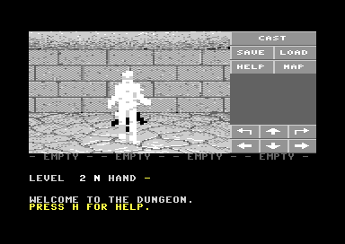
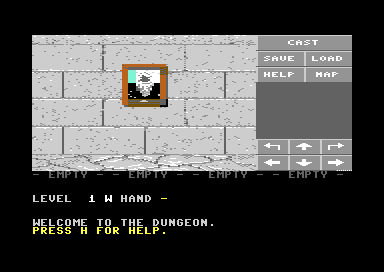
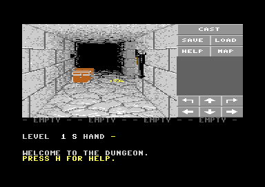

# Dungeon Master 64

A Commodore 64 port of FTL's *Dungeon Master* (Atari ST, 1987), written in C for cc65. It's
built from **your own copy of the original disk**: the build reads `Dungeon Master.stx` and
converts the real dungeon, texts, object names and rules tables. The C64 engine around them is
new code, not a decompile.





*A mummy on level 2; Elija in his mirror in the Hall of Champions; a chest, some bones and
torch holders. Everything in the view is DM's own pictures, in a multicolour bitmap; the mummy
is DM's own picture as C64 sprites. Screenshots from VICE.*

None of the game's data is in the source files. `tools/dmconv.py` extracts it into `gen/` and
`bin/` at build time. Don't share those folders or the disk image they produce.

## What you need

- **A C64 with a RAM expansion**: an REU (512K or more) or a SuperCPU. The 14 levels, the
  overlays and the pictures the view is drawn from are kept in far memory through the
  [FarMem](../Tedide/samples/FarMem) library. Only the level the party is on sits in the C64's
  own RAM. In VICE, use `-reu -reusize 512`.
- **A 1581 disk drive** or something that acts as one (an SD2IEC, an Ultimate, VICE): the game
  is a D81 image, as a 1541's disk can't hold it and two saved games.
- To build: Python 3, cc65 (`C:\cc65`), VICE 3.x (for `c1541`), and Tedide's FarMem sources in
  `..\Tedide\samples\FarMem`.

## Building and running

```powershell
.\build.ps1          # convert, compile, make bin\dm64.d81
.\build.ps1 -Run     # ...and start it in VICE with a 512K REU
```

Or open `DM64.tsln` in Tedide. It builds the FarMemC64 library, runs the converter as a
pre-build step and makes the disk image as a post-build step. Its VICE arguments attach the disk
image and add the REU.

The disk holds seven files: `DM64` (the program), and `DMHI`, `DMLEV`, `DMOVL`, `DMSPR`, `DMTXT`
and `DMWAL` (characters and the panel, levels, overlays, creature sprites, texts, and the view's
pictures). On a real machine: `LOAD"DM64",8,1` then `RUN`. `DMWAL` is packed on the disk
(about 190K) and unpacked into far memory as the game starts, so loading takes a while on a
real 1581; a fast loader, an SD2IEC or an Ultimate helps.

Saved games go on the same disk, as `DMSAVE1` and `DMSAVE2`. A save holds only the levels the
party has been on, packed: about 10 blocks early on, up to about 120 with every level visited,
so both slots always fit. Both
`build.ps1` and Tedide's post-build step (`tools\mkdisk.ps1`) keep them when they remake the
disk image. A save only loads into a build made from the same game data, and `SAVE_VERSION` in
`src/save.c` must go up whenever the saved structures change.

## Playing

You start outside the Hall of Champions. Walk in, look into the mirrors, and recruit up to four
champions. Each comes with their real statistics and possessions from the original.

| Key | Action |
| --- | --- |
| W / cursor up | Forward |
| S / cursor down | Back |
| A, D | Step left, right |
| Q / cursor left, E / cursor right | Turn left, right |
| Space | Press what's ahead: a wall switch, keyhole, door button or mirror; take from or put into an alcove |
| T | Take an object (from the wall ahead, or from the floor) |
| G | Put down what's in your hand (into an alcove ahead, or on the floor) |
| 1-4 | That champion attacks with the weapon in their action hand |
| I | Inventory: A-O swap your hand with a slot, 1-4 pick a champion, E eat/drink/read |
| X | Eat, drink or read what's in your hand |
| C | Cast a spell (see below) |
| P | The map of the level, as far as the party has seen it |
| H | Help |
| F1, F3 | Save, load (slot 1 or 2). When the party dies, F3 loads a game |
| M | Mouse: off, a 1351 mouse in port 1, or a pointer moved by a joystick in port 2 |

The game runs in real time, as the original does. Creatures move and attack whether you press
keys or not.

### Mouse

With the pointer on, everything can be clicked:

- **The view:** the wall, door or mirror ahead presses it, as Space does. The floor (the lower
  part of the view) takes an object, or puts down what's in your hand.
- **A champion's name or bars** (under the view): opens their inventory. **Their hand** (the
  line under the bars): attacks.
- **The buttons beside the view:** **CAST**, **SAVE**, **LOAD**, **HELP** and **MAP** do what
  they say. The pad under them: turn left, forward, turn right; step left, back, step right.
- **The status line** under the party (what's in hand, what's on the floor): takes an object, or
  puts down what's in your hand.
- **The inventory:** a slot swaps it with your hand. Click a champion to switch to them, or
  **[EAT/DRINK]** or **[BACK]**.
- **Casting:** the runes on offer, then **CAST**, **BACK** or **CANCEL**.
- **The right button** backs out of any screen.

A 1351's buttons share lines with the keyboard, so the C64 sees phantom key presses while one
is down; the game throws those away. Mouse support is new and has had little testing yet.

### Magic

Press C, choose who casts, then pick runes with 1-6, one row at a time: a power rune (LO, UM, ON,
EE, PAL, MON), then up to three more from the element, form and class rows. Each rune costs
mana as you pick it; DEL takes the last one back. RETURN casts and SPACE gives up. The game
waits while you choose, unlike the original. The spells are DM's own. The dungeon's scrolls and
walls teach some of them: VI into an empty flask heals, FUL IR is a fireball, and ZO opens doors.
A spell needs a skill level of its own level plus the power. A caster short of it may fail,
though less often the wiser they are.

## What's in it

### Taken from the original disk

- All 14 levels, square by square, with every door, pit, staircase, teleporter, fake wall,
  pressure plate, switch, keyhole, alcove, text, creature and object where FTL put them.
- The dungeon's texts (wall writing, messages, scrolls, champion descriptions), decoded from
  DM's 5-bit packed format.
- Object names, and the rules tables from `GRAPHICS.DAT`: weapon damage and weight, armour
  defence, which slots each object fits, and each creature type's speed, attack, defence,
  poison and dexterity, and which creatures are non-material. These are FTL's own LZW-packed
  tables, unpacked by `tools/dmgfx.py`.
- The spell table: all 25 spells' runes, required skill levels, skills, kinds and strengths,
  and the runes' mana costs.
- **The creatures' own pictures**: every creature's front view from `GRAPHICS.DAT`, in DM's
  palette with each creature's colour replacements, shrunk to C64 multicolour sprites by
  `tools/dmimg.py`. FTL's picture packing was decoded with the help of ScummVM's Dungeon
  Master engine.
- **The view's own pictures**: DM's floor, ceiling, walls, door frames, its four kinds of
  door with their ornaments (iron bars you can see through, locks, jewels) and buttons, its
  stairs, its 60 wall ornaments (switches, levers, locks, alcoves, torch holders, fountains,
  the champions' mirrors with their portraits), floor ornaments (pressure pads, grates, moss),
  pits, teleporter fields, the objects lying about, spells in flight, and its engraved
  lettering for writing on walls. They're cut, shrunk and placed as DM does it (the tables
  come from ScummVM's engine), including the ornaments DM scatters on plain walls at random,
  and converted to C64 multicolour by `tools/dmview.py`.

### The engine

- A first-person view the size of DM's (224x136), in a multicolour bitmap above the text, built
  as DM builds it: the floor and ceiling, then for each square far to near its walls and their
  ornaments, doors, stairs, pits, floor ornaments, objects, spells and teleporter fields. A
  raster interrupt switches from the bitmap to text partway down the screen. Messages on the
  floor appear below. The view is drawn straight onto the screen (there's no room for a second
  one), so you can see it being redrawn, for a moment, when something changes.
- Creatures drawn from DM's own pictures. The one ahead is a large sprite that shifts between
  two frames (the second mirrored, as DM does) and flashes white when hit; up to three more,
  farther off or to the sides, are small sprites, hidden when something nearer is in the way.
- Sensors: floor plates (anything, party, object, party carrying an object, facing a
  direction), wall switches, keyholes that keep the key, any-object and specific-object
  sensors, AND/OR gates and countdowns. Effects are set, clear, toggle and hold, with delays,
  once-only and reversed. They open and close doors, pits and teleporters, and show or hide texts.
  The sensor bit layout was worked out from the data (a target's coordinates land on the doors
  it should open, for example). The gates' and countdowns' details are a best guess.
- Doors that slide shut and open over time, door buttons, and doors that won't close on the party.
- Stairs and pits between levels, lined up by each level's place in the dungeon. Teleporters
  move the party, within a level or to another one, with their rotation.
- Recruiting champions from the mirrors, with an inventory of 15 slots each. Objects travel
  with the party from level to level.
- Melee combat using the weapon tables. Creature groups chase and attack at their own speeds,
  and drop what they carry when they die. Weapons pass through non-material creatures (ghosts,
  black flames, materializers, water elementals): only magic, or a Vorpal Blade, hurts them.
- Magic: casting with mana costs and skill checks, and spells as projectiles that fly through
  the view (fireball, lightning, poison bolt and cloud, harm non-material, and ZO, which opens
  doors; fireballs blast open doors that can be burnt), potions cast into empty flasks (all
  nine), party and fire shields, invisibility (creatures stop chasing), and ZOKATHRA.
- A map of each level, showing only what the party has seen: walls, doors, stairs, open pits,
  visible teleporters and objects on the floor. It's kept with the level, so it's saved too.
- Food, health/stamina/mana recovery, potions (VI, MON, EE, ROS, KU, DANE, NETA, water), and
  scrolls.
- Light and darkness, by DM's rules (`src/light.c`): every level but the first is dark, lit
  by torches in the champions' hands (as bright as their charges, burning down as time
  passes), an illumulet, and the light, magic torch and darkness spells, whose light fades
  away step by step. The view darkens through DM's six palettes: each of the C64's colours in
  it becomes, at each level, the C64 colour nearest to what DM shows (`tools/dmview.py`).

### Not yet

- Magic vision, magic footprints, water, experience and levelling up, and poison. Spells can't yet be learnt
  better through practice.
- The dungeon's projectile launchers and creature generators, and creatures casting spells.
- DM's exact formulas for spell damage, shield strength and how long spells last. The ones
  here are simpler stand-ins, scaled by the spell's strength from the table and the power rune.
- Throwing and shooting, bashing doors, creatures using doors and pits, and teleporting objects
  and creatures.
- Creatures' side, back and attack views, stairs seen from the side, holes in the ceiling
  under pits, doors that slide sideways as they open (they all slide up here), footprints,
  DM's champion portraits in the panel, and sound.
- The endgame: the Firestaff, Lord Chaos and the fluxcage.

## How it fits in a C64

```text
$0400-$07FF  buffers (the default screen's RAM)           LOWBSS segment, c64-dm64.cfg
$0801-$BEAB  the program, rules tables, the party's level (3.2K buffer), the party's objects
$BEAC-$BF7F  free (about 200 bytes)
$BF80-$C9FF  the overlay area: whichever overlay is in use (2.6K)
$CA00-$CBFF  C stack (512 bytes)
$CC00-$CFFF  the screen; its top 17 rows are the bitmap's colours
$D000-$D3FF  character set             } in the RAM under the I/O area; the video chip uses
$D400-$D6FF  sprites (creatures, from  } bank 3 and always sees RAM there, the CPU writes
             far memory; the pointer)  } with I/O switched out (hw.c: hi_read)
$DC00-$DE3F  DM's inscription font, as bitmap cells
$E000-$FF3F  the bitmap (its top 17 rows: the view, and the panel beside it), in the RAM
             under the KERNAL
far memory   the 14 level images, about 34K (DMLEV), the overlays, 13K (DMOVL), the
             creatures' sprites, 8.6K (DMSPR), the dungeon's texts, object names and our
             own strings and some tables, 7K (DMTXT), and the view's pictures, 382K (DMWAL): about 450K
```

The screen is split by a raster interrupt (`src/irq.s`): its top 17 rows are a multicolour
bitmap, the rest text. The bitmap's colours share the text screen's memory, so the sprites
have one set of pointers. In the bitmap, every cell has the same background (mid grey) and
the same two other greys (dark and light), and one colour of its own; DM's view is nearly all
greys, so its pictures fit without clashing. Each picture is stored (DMWAL) as the bitmap bytes
of the cells it covers, with masks for the cells it covers only partly, and copied in by
`src/bitmap.s`. That code switches the KERNAL out to reach the bitmap underneath, and
interrupts go on meanwhile: the RAM under the KERNAL's vectors points to a handler that
switches it back in. Objects and spells in flight, which can be anywhere, are stored once per
size and shifted into place a row at a time as they're drawn.

Each level image (see the top of `tools/dmconv.py`) holds the level's squares, the start of
each square's object list, its own tables of doors, teleporters, texts, sensors, creatures
and objects, and a bit for each square the party has seen, for the map. Things are numbered
within the level, so the image can be copied in and out of far memory whole. Objects the party
picks up move into a separate pool (`dungeon.c`), which is how they cross levels.

Code that's only needed now and then lives in **overlays** (`src/overlay.c`): recruiting,
the inventory, help and the map, the casting screen, saving and loading, and unpacking DMWAL
at the start. The linker (`c64-dm64.cfg`) builds each to run in the same 2.6K area, the build
joins them into DMOVL, and the game keeps them in far memory, copying one into the area when
it's called. An overlay can call anything in the main program, but nothing in another overlay.
A new rarely used feature belongs in one. The largest (saving) sets the area's size,
`__OVLSIZE__` in the config. (cc65 writes a file's string literals at its end, into whatever
segment is in force there: so an overlay's file doesn't pop its segments at the end, or its
strings would land in the main program.)

## Source

| File | |
| --- | --- |
| `tools/dmdat.py` | Reads the STX (Pasti) disk image, its FAT12 file system, and `DUNGEON.DAT` |
| `tools/dmgfx.py` | Unpacks `GRAPHICS.DAT`: object names, the rules tables and the spells |
| `tools/dmimg.py` | Decodes DM's pictures and makes the creature sprites |
| `tools/art.py` | The custom characters, the bitmap's tiny font, icons and button panel, and the mouse pointer (hand-drawn) |
| `tools/text.py` | The game's own help text |
| `tools/dmconv.py` | Writes `gen/dmdata.c`, `gen/glyphs.h` and the DMLEV, DMHI, DMSPR, DMTXT and DMWAL files |
| `tools/dmview.py` | Converts DM's view pictures into DMWAL's pieces and packs them; on its own, draws mockups of DM's view beside the C64's |
| `tools/mkdisk.ps1` | Joins the overlays into DMOVL and makes the disk image, keeping saves |
| `src/main.c` | Start-up, main loop, keys |
| `src/dungeon.c` | Levels and overlays in far memory, squares, object lists, objects, texts |
| `src/view.c` | The 3D view and sprites |
| `src/irq.s` | The raster split between the bitmap and the text |
| `src/bitmap.s` | Drawing into the bitmap: DMWAL's pieces, objects (shifted into place), lettering |
| `src/ui.c` | Messages, the party and status lines, the screen modes, keyboard and mouse input |
| `src/mouse.s` | The mouse pointer, for cc65's mouse drivers |
| `src/party.c` | Champions: combat, eating and drinking |
| `src/sensor.c` | Sensors, doors, pits, stairs, teleporters, moving and clicking |
| `src/creature.c` | Creatures on the party's level |
| `src/magic.c` | Projectiles, and spells running down |
| `src/light.c` | Light and darkness: torches, light spells, which palette |
| `src/overlay.c` | The way into each overlay |
| `src/recruit.c` | Overlay: recruiting champions from the mirrors, and help |
| `src/screens.c` | Overlay: the inventory and the map, and choosing the mouse |
| `src/cast.c` | Overlay: casting spells, potions and the other spells |
| `src/save.c` | Overlay: saving and loading |
| `src/unpack.c`, `src/unpackasm.s` | Overlay: unpacking DMWAL into far memory as the game starts |
| `src/hw.c` | Video bank, RAM under the ROMs, data files, sound |

## Licence

The source code here is under the MIT licence: see [LICENSE](LICENSE). That covers this code
only. *Dungeon Master* and everything the build extracts from it (the dungeon, texts, names and
rules tables in `gen/` and `bin/`) remain FTL's, and aren't included or licensed here. The
FarMem library is part of Tedide and is used under its own terms.
